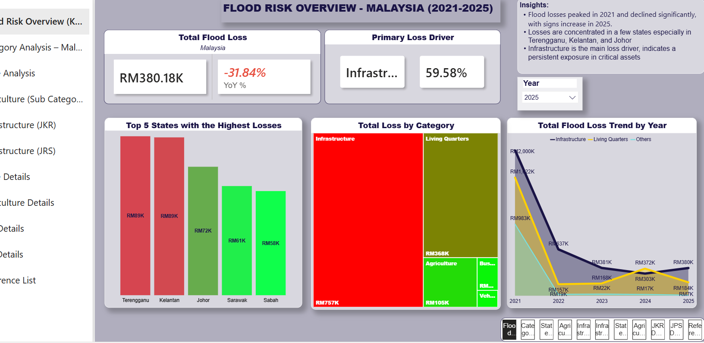

# Flood Loss Analysis Dashboard

## Project Overview

This project analyses flood losses in Malaysia from 2021 to 2025 using Power BI. 

## Data Source
Department of Statistics Malaysia

| Year | Link |
| --- | --- |
| 2025 | [2025](https://open.dosm.gov.my/publications/flood_impact_2025) |
| 2024 | [2024](https://open.dosm.gov.my/publications/flood_impact_2024) |
| 2023 | [2023](https://open.dosm.gov.my/publications/flood_impact_2023) |
| 2022 | [2022](https://open.dosm.gov.my/publications/flood_impact_2022) |
| 2021 | [2021](https://open.dosm.gov.my/publications/flood_impact_2021) |

---

## Tools Used

- Microsoft Power BI
- Excel
- DAX

## Key Features

- Total flood losses
- Year-over-year trends
- Regional analysis
- Interactive dashboard

## Skills Demonstrated

- Data Analysis
- Data Visualisation
- Dashboard Development
- Business Intelligence

## Dashboard

